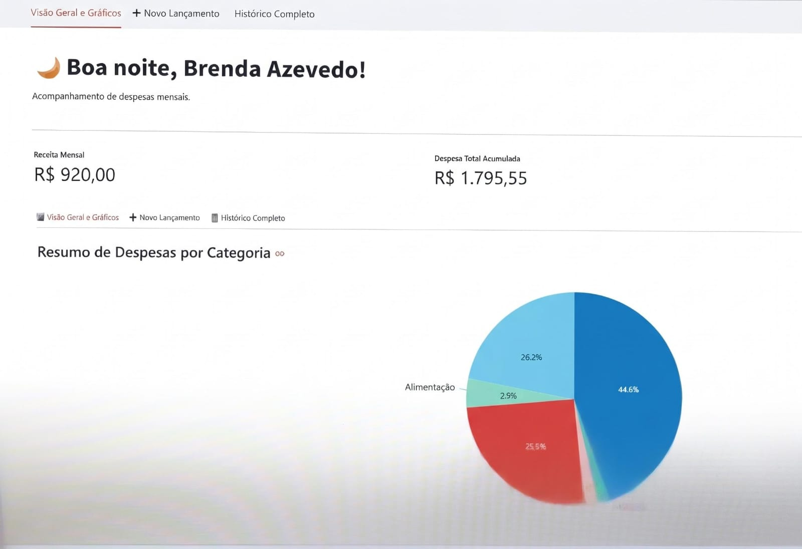

# 💰 Sistema de Controle Financeiro Pessoal

Aplicação web interativa desenvolvida em **Python** com **Streamlit** para gerenciamento de finanças pessoais, permitindo registrar receitas e despesas, acompanhar o saldo mensal e visualizar a distribuição dos gastos por categoria.



## 🎯 Funcionalidades
- **Visão Geral e Indicadores:** Exibição rápida da receita mensal e da despesa total acumulada.
- **Gráficos Interativos:** Análise visual da proporção de despesas por categoria utilizando **Plotly**.
- **Novo Lançamento:** Formulário simples para cadastrar receitas e despesas com data, categoria, descrição e valor.
- **Histórico Completo:** Tabela detalhada com filtro por tipo de lançamento (Receita ou Despesa).
- **Persistência de Dados:** Armazenamento automático de registros em arquivo local (`gastos.csv`).

## 🛠️ Tecnologias Utilizadas
- **Python** — Linguagem principal do projeto
- **Streamlit** — Criação da interface web interativa
- **Pandas** — Manipulação, filtragem e leitura de dados em CSV
- **Plotly** — Geração de gráficos interativos

## 📂 Estrutura do Projeto
```text
controle-financeiro/
├── app.py           # Código principal da aplicação Streamlit
├── gastos.csv       # Base de dados local com os lançamentos
├── painel.jpeg      # Captura de tela da interface do sistema
├── requisitos.txt   # Dependências do projeto
└── readme.md        # Documentação do repositório
```

## ⚙️ Como Executar Localmente
```bash
git clone [https://github.com/brsa1409-lab/controle-financeiro.git](https://github.com/brsa1409-lab/controle-financeiro.git)
cd controle-financeiro
pip install -r requisitos.txt
streamlit run app.py
```
